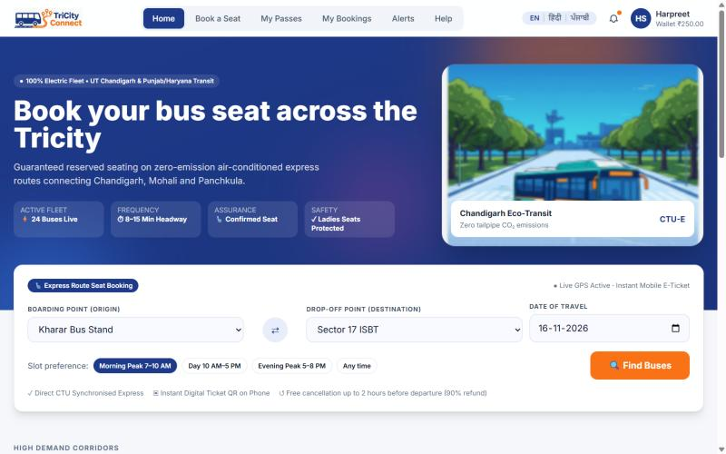
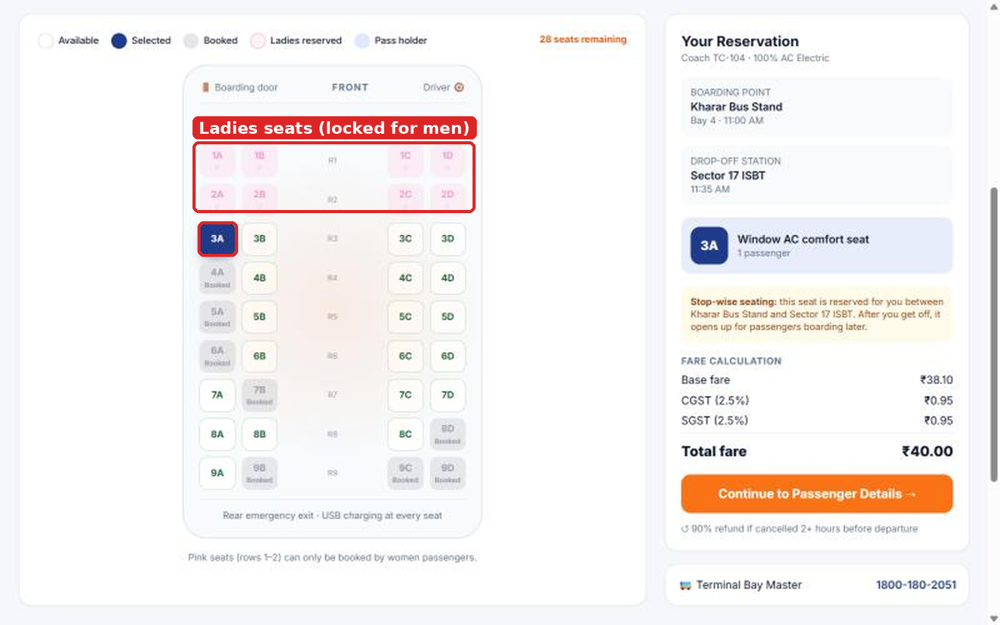
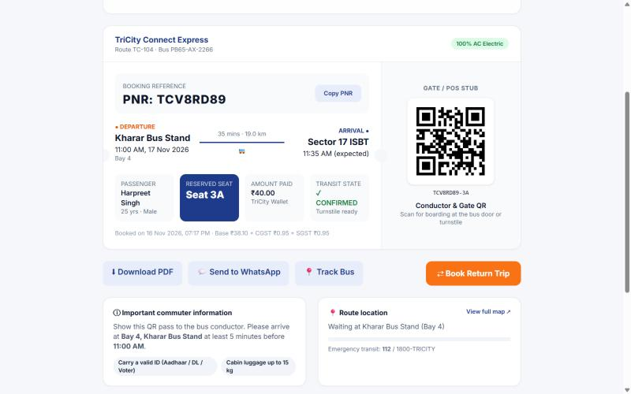
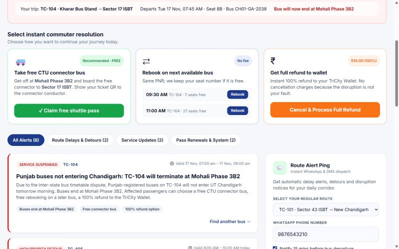
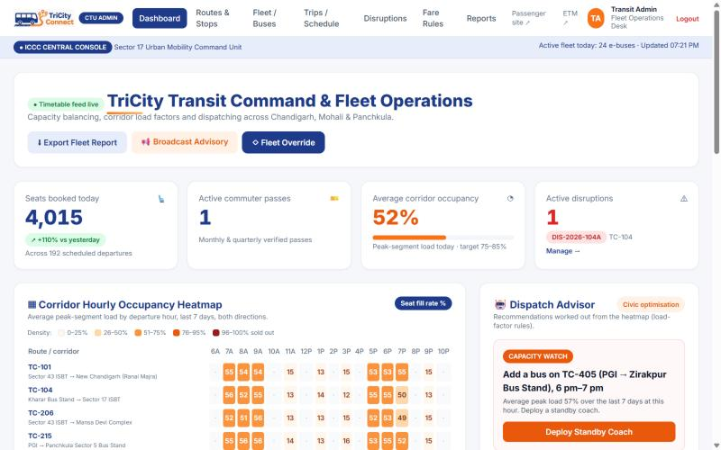
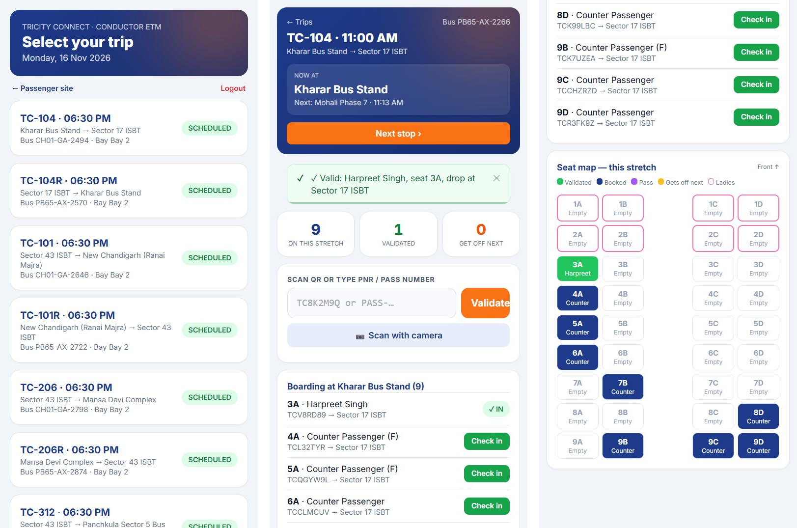

# TriCity Connect

**Intercity bus seat reservation and commuter pass system for Chandigarh (UT), Mohali (Punjab) and Panchkula (Haryana).**


Mini project for **UCS553: Enterprise Web Application**, Thapar Institute of Engineering and Technology, Patiala.

| Name | Roll number |
|---|---|
| Amberneal Singh | 1024030617 |
| Ishaan Garg | 1024030604 |

Subgroup **3C44** · Guide: **Vikramjit Singh Bhathal**, Assistant Professor



---

## Table of contents

1. [Problem statement](#1-problem-statement)
2. [Features](#2-features)
3. [Screenshots](#3-screenshots)
4. [Tech stack](#4-tech-stack)
5. [How to run](#5-how-to-run)
6. [Demo logins](#6-demo-logins)
7. [Running the tests](#7-running-the-tests)
8. [Manual test cases](#8-manual-test-cases)
9. [Project structure](#9-project-structure)
10. [How it works](#10-how-it-works)
11. [Future scope](#11-future-scope)

---

## 1. Problem statement

Daily commuters across Chandigarh, Mohali and Panchkula cannot book a guaranteed seat on crowded intercity buses. Ladies seats are not enforced, and passengers get no warning or alternative when a dispute between the three governments stops a bus service at the border.

The project covers the six busiest Tricity corridors from the RITES Comprehensive Mobility Plan, in both directions (12 routes):

| Route | Corridor |
|---|---|
| TC-101 | Sector 43 ISBT to New Chandigarh |
| TC-104 | Kharar Bus Stand to Sector 17 ISBT |
| TC-206 | Sector 43 ISBT to Mansa Devi Complex |
| TC-215 | PGI to Panchkula Sector 5 |
| TC-312 | Sector 43 ISBT to Panchkula Sector 5 |
| TC-405 | PGI to Zirakpur |

---

## 2. Features

### Passenger

| Feature | Where in the code |
|---|---|
| Search buses between any two stops, with filters and sorting | `SearchService`, `results.html` |
| **Stop-wise seat booking**: a seat is held only between the passenger's own stops, so it can be sold again after they get off | `core/SeatSegments`, `SeatService`, `BookingService` |
| No double booking: the trip row is locked while booking (`SELECT ... FOR UPDATE`) | `TripRepository.lockById`, `BookingService.book` |
| Ladies seats (rows 1 and 2) can only be booked by women | `core/SeatLayout`, `BookingService` |
| Peak / off-peak fares with GST split into CGST + SGST | `core/FareCalculator` |
| Student and senior citizen concession (50%) | `core/Concession`, `checkout.html` |
| Payment by UPI, card or net banking (simulated) and TriCity Wallet (real balance) | `BookingService` |
| E-ticket with QR code and PDF download | `QrService`, `TicketPdfService` |
| Cancellation with refund to wallet (90% / 50% / 0%) | `core/RefundPolicy` |
| Live bus tracking (worked out from timetable and delays) | `TrackingService` |
| Monthly commuter pass with a fixed seat on fixed buses | `PassService`, `core/PassPricing` |
| **Disruption handling**: affected passengers choose a free connector bus, a free rebooking or a 100% refund | `DisruptionService`, `alerts.html` |
| Profile and wallet: top-up, history, CSV statement, emergency contact | `ProfileController`, `WalletService` |
| Help Centre with FAQ, chat assistant and complaints | `HelpService`, `help.html` |
| English, Hindi and Punjabi | `messages*.properties` |
| Login with roles (Passenger / Conductor / Admin), BCrypt passwords | `SecurityConfig`, `UserService` |

### Admin console (`/admin`)

| Screen | What it does |
|---|---|
| Dashboard | Seats booked today, occupancy, 7-day trend, route-by-hour heatmap, suggestions to add or reduce buses |
| Routes & stops | View stops, distance and fares; add or remove a stop; create a new corridor |
| Fleet | Add buses and change their status (active / maintenance / charging / standby) |
| Trip scheduling | Add or bulk-schedule trips, change the bus, cancel a trip (100% refund to everyone), passenger list |
| Disruptions | Publish a suspension, short-termination, delay or diversion and resolve it |
| Fare rules | Change ₹/km, peak multiplier, GST, concessions and pass discounts; demand calendar; fare calculator |
| Reports | Revenue, passengers, occupancy by hour, boardings by state, ladies-seat use, CSV export |

### Conductor app (`/conductor`, made for phones)

Pick today's trip, see who boards at each stop and a live seat map, and check tickets by QR scan or by typing the PNR / pass number.

---

## 3. Screenshots

| Seat map | E-ticket |
|---|---|
|  |  |

| Disruption options | Admin dashboard |
|---|---|
|  |  |

**Conductor app**



The full project report with all screenshots is in [`docs/`](docs/).

---

## 4. Tech stack

| Layer | Technology |
|---|---|
| Language | Java 17 |
| Framework | Spring Boot 3.3 (Spring MVC, Spring Data JPA, Spring Security, Validation) |
| Database | MySQL 8 (H2 in-memory for tests and quick runs) |
| ORM | Hibernate |
| Front end | Thymeleaf, HTML, Tailwind CSS, JavaScript |
| PDF / QR | OpenPDF, ZXing |
| Testing | JUnit 5, Spring Boot Test, MockMvc |
| Build | Maven |

---

## 5. How to run

**You need:** JDK 17 or newer and Maven 3.9+ (or IntelliJ IDEA, which includes Maven). MySQL 8 is optional.

### Option A: quick start, no MySQL

```bash
mvn spring-boot:run -Dspring-boot.run.profiles=h2
```

On Windows PowerShell put the last part in quotes:

```powershell
mvn spring-boot:run "-Dspring-boot.run.profiles=h2"
```

This uses an in-memory database that resets on every restart. Database console: http://localhost:8080/h2-console (JDBC URL `jdbc:h2:mem:tricity`, user `sa`).

### Option B: with MySQL

1. Start MySQL. The database `tricity_connect` is created automatically.
2. Set your MySQL username and password in `src/main/resources/application.properties`:
   ```properties
   spring.datasource.username=root
   spring.datasource.password=root
   ```
3. Run:
   ```bash
   mvn spring-boot:run
   ```

### In IntelliJ IDEA

File → Open → select the `tricity-connect` folder → wait for Maven to load → run `TriCityConnectApplication`. For the H2 option, set **Active profiles** to `h2` in Run → Edit Configurations.

Then open **http://localhost:8080**.

### Demo data

On the first start the app creates 6 corridors (12 routes), 28 buses, about 2,700 trips (last 7 days and next 7 days) and about 32,000 bookings, so the dashboard and reports look realistic. With MySQL the first start takes 1 to 2 minutes; later starts are fast. To start again from zero: `DROP DATABASE tricity_connect;`

Also added on purpose for the demo:

- A **live disruption**: TC-104 tomorrow 07:00 to 09:00 ends at Mohali Phase 3B2. Harpreet's 07:45 booking is affected, so his Alerts page shows the connector / rebook / refund choices.
- A resolved delay on TC-312 yesterday.
- The TC-104 08:35 bus today is completely full.

---

### Deploy online (Render, free)

The repo has a `Dockerfile` and a `render.yaml`, so it can be deployed straight from GitHub.

1. Sign in at https://render.com with GitHub.
2. Click **New > Blueprint** and pick this repository. Render reads `render.yaml` and creates the web service.
3. Wait for the build (about 5 to 8 minutes the first time). The site opens at `https://tricity-connect-xxxx.onrender.com`.

Notes:
- The free plan uses the built-in H2 database, so demo data is reset on every restart.
- A free service sleeps after 15 minutes without visits. The first visit after that takes about a minute.
- To keep data, create a MySQL database (for example on Aiven or Railway) then in the Render environment settings delete `SPRING_PROFILES_ACTIVE` and add `DB_URL`, `DB_USER` and `DB_PASSWORD`.

## 6. Demo logins

| Role | Login | Password |
|---|---|---|
| Passenger (male) | `9876543210` | `password123` |
| Passenger (female, can book ladies seats) | `9812345678` | `password123` |
| Admin | `admin@tricity.in` | `admin123` |
| Conductor | `conductor@tricity.in` | `conductor123` |

---

## 7. Running the tests

```bash
mvn test
```

The tests use an in-memory H2 database, so MySQL is not needed.

| Test | What it checks |
|---|---|
| `core/*Test` | Fares, refunds, stop overlap, pass price, seat layout, fare rules, demand index |
| `service/BookingFlowTest` | Search, stop-wise booking, overlap rejection, ladies rule, wallet charge and refund, pass seats |
| `service/OperationsFlowTest` | Disruption rebook, 100% refund on suspension, conductor check-in, trip cancel, reports, fare rule changes |
| `web/PagesTest` | Every passenger, admin and conductor page opens; languages; login and role rules |

---

## 8. Manual test cases

| # | Test | Steps | Expected result |
|---|---|---|---|
| 1 | Search | Home → Kharar Bus Stand → Sector 17 ISBT → Find Buses | TC-104 buses with time, fare and seats left |
| 2 | Full bus | Search Kharar → Sector 17 today, morning | 08:35 bus shows "Bus Full" |
| 3 | Stop-wise booking | Book seat X Kharar → Phase 7 as `9876543210`, then seat X Phase 7 → Sector 17 as `9812345678` | Both bookings succeed |
| 4 | Overlap blocked | Try seat X Kharar → Phase 3B2 on the same bus | Seat shows as Booked |
| 5 | Ladies seat | Log in as `9876543210` and open a seat map | Rows 1 and 2 are locked |
| 6 | Wallet payment | Pay with TriCity Wallet | Wallet balance goes down by the fare |
| 7 | Cancel and refund | My Bookings → Cancel (trip more than 2 h away) | 90% credited to wallet |
| 8 | PDF ticket | Confirmation → Download PDF | PDF with PNR, seat and QR |
| 9 | Commuter pass | My Passes → Get New Pass → Buy | Pass card with QR; seat shows "Pass" on those buses |
| 10 | Security | Open `/bookings` while logged out | Redirected to login |
| 11 | Roles | Log in as passenger, open `/admin` | Access blocked |
| 12 | Language | Click हिंदी / ਪੰਜਾਬੀ | Menu and home page change language |
| 13 | Disruption choice | As `9876543210` open Alerts → Rebook | Moved to a later bus at no extra cost |
| 14 | Publish disruption | Admin → Disruptions → Suspended, TC-206, next 2 h → Publish | Trips marked, affected passengers counted |
| 15 | Fare rule change | Admin → Fare Rules → ₹/km = 2.50 → Save | New fares go up; old tickets unchanged |
| 16 | Cancel a trip | Admin → Trips → Cancel | All passengers refunded 100% |
| 17 | Conductor check-in | Conductor → pick a trip → enter PNR → Validate | "Valid", and "Already checked in" the second time |
| 18 | Wrong bus | Validate a PNR from another trip | "Ticket is for another bus" |
| 19 | Reports | Admin → Reports → change dates → CSV | Numbers update; CSV downloads |
| 20 | Help assistant | Help → "next bus from Kharar to Sector 17" | Next bus, time, seats and fare |

---

## 9. Project structure

```
tricity-connect/
├── pom.xml
├── database/schema.sql          MySQL schema
├── docs/                        Project report and screenshots
└── src/
    ├── main/java/com/tricityconnect/
    │   ├── core/                Business rules in plain Java (fares, refunds, seat overlap, pass price)
    │   ├── model/               JPA entities = database tables
    │   ├── repository/          Spring Data JPA interfaces
    │   ├── service/             Business logic
    │   ├── dto/                 Form objects
    │   ├── web/                 Controllers (web/admin for the admin console)
    │   └── config/              Security, language switch, demo data
    ├── main/resources/
    │   ├── templates/           Thymeleaf pages (passenger, admin, conductor)
    │   ├── static/              CSS, JavaScript, images
    │   └── messages*.properties English, Hindi and Punjabi text
    └── test/java/               JUnit 5 tests
```

**Architecture:** MVC with layers: Controller → Service → Repository → MySQL.

---

## 10. How it works

**Stop-wise booking.** Stops on a route are numbered 1, 2, 3 and so on. Two bookings of the same seat clash only if `newFrom < oldTo AND oldFrom < newTo`, so a seat freed at Phase 7 can be sold again from Phase 7 onwards.

**No double booking.** `BookingService.book` is `@Transactional` and starts by locking the trip row. A second request for the same bus waits, then sees the seat is taken. If anything fails, everything is rolled back and the wallet is not charged.

**Fares.** Distance × ₹2, × 1.2 at peak hours (7 to 10 AM, 5 to 8 PM), minus any concession, rounded to the nearest ₹5 (minimum ₹10). The 5% GST is included and shown as CGST + SGST on the ticket. The admin can change these values without restarting the app.

**Passwords.** Stored as BCrypt hashes, never as plain text.

**Disruptions.** The admin publishes a disruption once. All trips in that time window are marked as cancelled, cut short or delayed, search stops selling seats beyond the new last stop, and each affected passenger chooses a connector bus, a rebooking or a full refund.

**Dashboard suggestions.** The average load of each route at each hour over the last 7 days is used: 50% or more suggests an extra bus, 30% or less suggests reducing buses.

---

## 11. Future scope

- Real payment gateway (UPI / Razorpay)
- SMS and WhatsApp alerts and OTP login
- Real GPS feed from the buses
- Android app
- Demand prediction with machine learning
